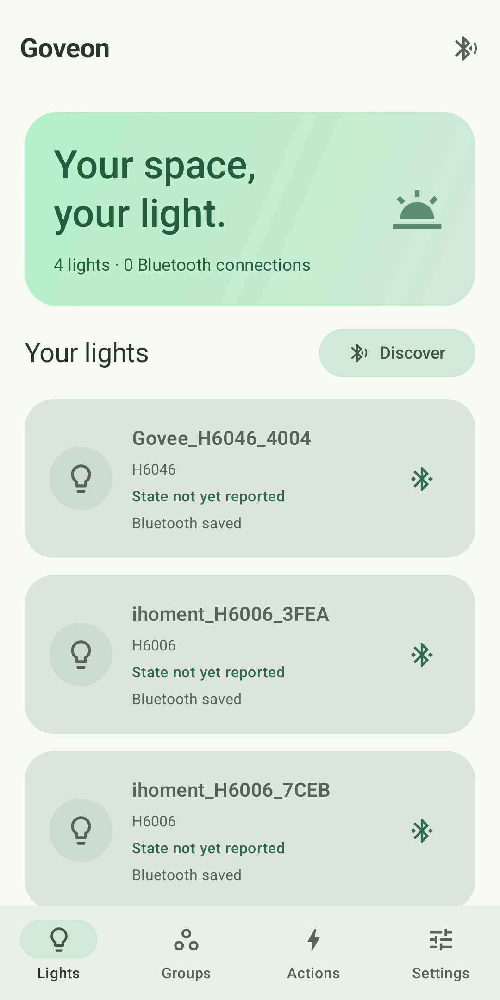
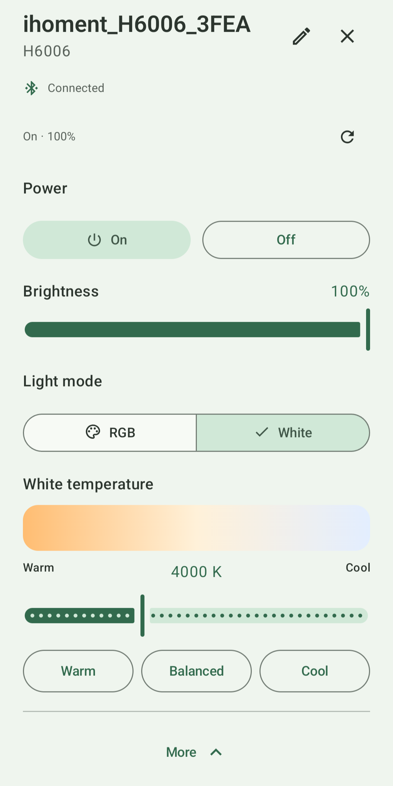
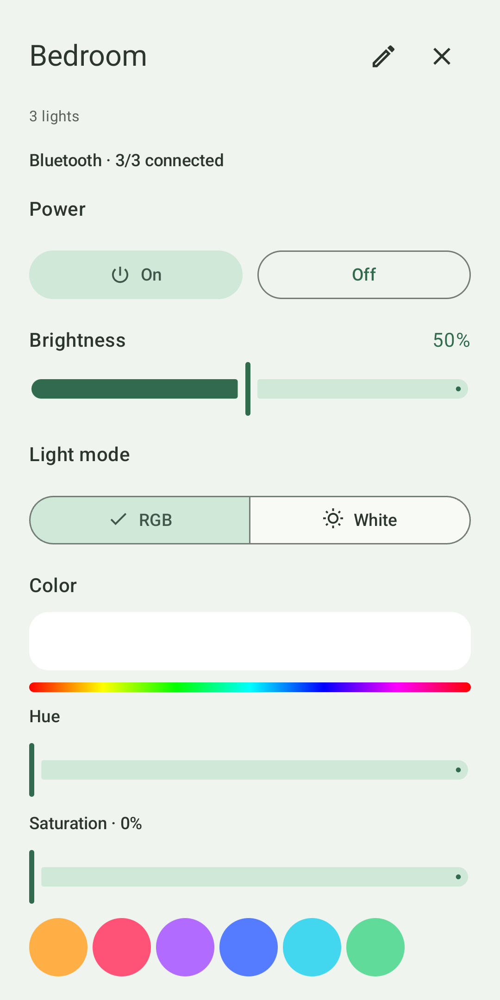
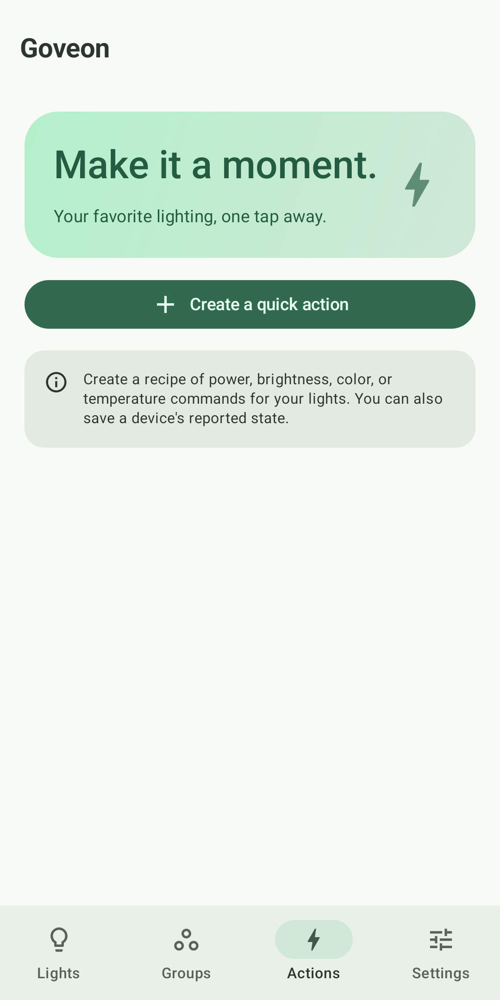

# Goveon

An Android app for controlling supported Govee lights over Bluetooth and your local Wi-Fi network. Adjust lights, group them by room, and save quick actions without a cloud account or developer API key.

Requires Android 8.0 (API 26) or newer and a supported light. Device support depends on the model and firmware; see [device coverage](docs/ble-protocol.md). No analytics or Goveon server.

## Download

Download the signed APK from [GitHub Releases](https://github.com/AldogPlays/Goveon/releases/latest). See the [1.0.0 release notes](docs/release-notes-1.0.0.md) for upgrade details.

## Screenshots

Click a screenshot to view it larger.

<table>
  <tr>
    <td align="center">
      <a href="docs/Screenshot_20261012-215029.png">
        
      </a>
      <br>
      <sub>Your lights</sub>
    </td>
    <td align="center">
      <a href="docs/Screenshot_20261012-215047.png">
        
      </a>
      <br>
      <sub>White temperature controls</sub>
    </td>
  </tr>
  <tr>
    <td align="center">
      <a href="docs/Screenshot_20261012-215109.png">
        
      </a>
      <br>
      <sub>Group color controls</sub>
    </td>
    <td align="center">
      <a href="docs/Screenshot_20261012-215138.png">
        
      </a>
      <br>
      <sub>Quick actions</sub>
    </td>
  </tr>
</table>

## Controls

- Discover nearby lights and connect directly over Bluetooth. Connections follow the open light/group page and reconnect quietly with bounded retries.
- Power, brightness, RGB and native White controls, including warm/balanced/cool presets and supported temperature steps. The identified device family determines the actual Bluetooth packets and brightness scale.
- Optional LAN discovery and control on the lights' Wi-Fi network, without credentials.
- Rename/forget lights, create custom groups, and save multi-light quick actions. Recipes validate before execution and serialize per light; different lights run concurrently.
- Material You colors on Android 12+, system/light/dark themes, animated navigation, compact feedback and optional advanced color details.

## Getting started

1. Power on a light, bring the phone nearby and tap **Discover**. Allow Nearby Devices and enable Bluetooth when prompted. Android 8–11 additionally requires Location permission and the Location switch for BLE scanning; Goveon does not collect location.
2. Open a light or group to connect automatically. Close other controllers' active connections if a light is busy. Goveon uses direct GATT for supported lights rather than an Android Settings bond.
3. H6005 and the recovered type-64 bulb family have native RGB/White controls. The latter includes H6004, H6006, H6008, H6009, H600A, H6010 and H600D, with 2700–6500 K in 100 K steps. Other H6 models require valid basic read replies before writes become available. A matching color read can enable RGB but never invents White support. Use **Set model** if an advertisement omits the controller's H6xxx label.
4. Optional Wi-Fi: enable **LAN Control** on an already provisioned compatible light, join the same network and tap **Find Wi-Fi lights**. Multicast, guest isolation and VPN policies can prevent replies.

## Device coverage

| Route | Available behavior | Boundary |
| --- | --- | --- |
| Bluetooth | Discovery, automatic connections, notifications, actual reads, profile-based power/brightness/RGB/White, groups/actions | Firmware variants and radio timing require hardware testing. See the protocol report. |
| LAN | Discovery, state, power, brightness, RGB and temperature | LAN-capable light, enabled LAN switch and same Wi-Fi. The protocol does not advertise its physical temperature range. |
| Authentication/provisioning | Not implemented | No guessed pairing secrets, account enrollment or Wi-Fi credential provisioning. |
| Scenes, music, segments, DreamView | Not shipped | Local family-specific protocols have not been confirmed. No speculative scene IDs or streaming commands. |

## Build and wired testing

Use JDK 17, Android SDK Platform 35 and build tools 35.0.0:

```powershell
./gradlew.bat :app:testDebugUnitTest :app:lintDebug :app:assembleDebug :app:testReleaseUnitTest :app:lintRelease :app:assembleRelease
```

Use `./gradlew` on Linux/macOS. `./scripts/toolchain.ps1 build` selects the configured workspace-local tools. See [toolchain setup](scripts/toolchain/README.md).

Download the signed APK from [Releases](https://github.com/AldogPlays/Goveon/releases/latest). Version 1.0 uses the optimized, non-debuggable release variant and the same local signing certificate as the 0.2/0.3 APKs for in-place updates. That retained certificate is labelled Android Debug; its private keystore stays outside Git. A fresh Gradle release build is unsigned until signed offline. Builds, tests and lint run locally. GitHub Actions is disabled for this repository, and no workflow files are included. See [toolchain setup](scripts/toolchain/README.md) for local validation commands.

To install a release over USB on a test device:

```powershell
adb devices -l
adb -s YOUR_SERIAL install -r goveon-1.0.0.apk
```

Open the app and follow the [hardware checklist](docs/testing.md).

## Privacy and development

Lights, groups, quick actions, and appearance settings stay in app-private storage. Android backup is disabled. Bluetooth scans and connections stop when the app goes into the background.

For protocol behavior, persistence, diagnostics, and public-source checks, see [implementation notes](docs/implementation-notes.md). Use the [manual hardware checklist](docs/testing.md) when testing a change.

The [REA reports](docs/reverse-engineering.md) distinguish observations, inference and unresolved hardware checks. Goveon implements original code and UI. [TrailRelay](https://github.com/AldogPlays/TrailRelay) inspired readable Material surfaces, contextual sheets and a small responsibility-based structure.

Goveon is independent of Govee and is not an official Govee product.

## License

Source code is licensed under the [MIT License](LICENSE).
